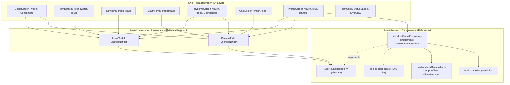

# Отчёт по Лабораторной работе № 4
## «State management и паттерн Repository с mock-данными»

**Дисциплина:** Разработка мобильных приложений (Flutter)  
**Тема проекта (T19):** LostFound — система поиска потерянных вещей в кампусе  
**Студент:** Георгиев Семион  
**Группа:** TI-236  
**Преподаватель:** Ionel Antohi  
**Учебное заведение:** Технический Университет Молдовы (UTM), Факультет FCIM  
**Год:** 2026  

---

## 1. Архитектура приложения

Архитектура построенного приложения строго разделена на три слоя в соответствии с принципами Clean Architecture и требованиями методички:



---

## 2. Эквивалентная таблица REST API (Контракт Репозитория)

В следующей таблице приведено соответствие методов `LostFoundRepository` гипотетическому REST API кампусного сервера:

| Метод `LostFoundRepository` | HTTP метод | Эндпоинт REST API | Описание | Возвращаемый тип |
|---|---|---|---|---|
| `fetchItems()` | `GET` | `/api/v1/items` | Получить список всех объявлений | `Result<List<CampusItem>>` |
| `fetchItemById(id)` | `GET` | `/api/v1/items/{id}` | Получить объявление по ID | `Result<CampusItem>` |
| `createItem(draft)` | `POST` | `/api/v1/items` | Создать новое объявление | `Result<CampusItem>` |
| `updateItem(item)` | `PUT` | `/api/v1/items/{id}` | Обновить объявление / статус | `Result<CampusItem>` |
| `deleteItem(id)` | `DELETE` | `/api/v1/items/{id}` | Удалить объявление | `Result<void>` |
| `fetchClaims()` | `GET` | `/api/v1/claims` | Получить список заявок пользователя | `Result<List<CampusClaim>>` |
| `createClaim(draft)` | `POST` | `/api/v1/claims` | Подать заявку на предмет | `Result<CampusClaim>` |
| `deleteClaim(id)` | `DELETE` | `/api/v1/claims/{id}` | Отозвать/удалить заявку | `Result<void>` |
| `fetchMessages(claimId)`| `GET` | `/api/v1/claims/{claimId}/messages` | Получить чат по заявке | `Result<List<ChatMessage>>` |
| `sendMessage(claimId, text)` | `POST` | `/api/v1/claims/{claimId}/messages` | Отправить сообщение в чат | `Result<ChatMessage>` |

---

## 3. Ключевые фрагменты реализации

### 3.1 `sealed class Result<T>` (`lib/data/result.dart`)
```dart
sealed class Result<T> {
  const Result();
}

class Ok<T> extends Result<T> {
  const Ok(this.value);
  final T value;
}

class Err<T> extends Result<T> {
  const Err(this.msg);
  final String msg;
}
```

### 3.2 Доменные модели (`lib/data/models.dart`)
```dart
enum ItemType { lost, found }
enum ClaimStatus { pending, accepted, rejected }

class CampusItem {
  final String id;
  final String title;
  final String description;
  final String location;
  final String date;
  final ItemType type;
  final String category;
  final bool isResolved;

  const CampusItem({
    required this.id,
    required this.title,
    required this.description,
    required this.location,
    required this.date,
    required this.type,
    required this.category,
    this.isResolved = false,
  });

  CampusItem copyWith({
    String? id,
    String? title,
    String? description,
    String? location,
    String? date,
    ItemType? type,
    String? category,
    bool? isResolved,
  }) {
    return CampusItem(
      id: id ?? this.id,
      title: title ?? this.title,
      description: description ?? this.description,
      location: location ?? this.location,
      date: date ?? this.date,
      type: type ?? this.type,
      category: category ?? this.category,
      isResolved: isResolved ?? this.isResolved,
    );
  }
}
```

### 3.3 Изолированная модель состояния `ItemsModel` (`lib/models/items_model.dart`)
> **Обратите внимание:** Файл импортирует *исключительно* `package:flutter/foundation.dart`, защищая списки через `List.unmodifiable(...)`.

```dart
import 'package:flutter/foundation.dart';
import '../data/lost_found_repository.dart';
import '../data/models.dart';
import '../data/result.dart';

class ItemsModel extends ChangeNotifier {
  final LostFoundRepository _repository;

  ItemsModel(this._repository);

  bool _loading = false;
  String? _error;
  List<CampusItem> _items = const [];

  bool get isLoading => _loading;
  String? get error => _error;
  List<CampusItem> get items => List.unmodifiable(_items);

  int get activeCount => _items.where((i) => !i.isResolved).length;
  int get resolvedCount => _items.where((i) => i.isResolved).length;

  CampusItem? byId(String id) {
    try {
      return _items.firstWhere((item) => item.id == id);
    } catch (_) {
      return null;
    }
  }

  Future<void> load() async {
    _loading = true;
    _error = null;
    notifyListeners();

    final result = await _repository.fetchItems();
    switch (result) {
      case Ok(:final value):
        _items = List.from(value);
        _error = null;
      case Err(:final msg):
        _error = msg;
    }
    _loading = false;
    notifyListeners();
  }
}
```

### 3.4 Внедрение зависимостей и корень композиции (`lib/main.dart`)
```dart
void main() {
  final repository = MockLostFoundRepository();

  runApp(
    MultiProvider(
      providers: [
        Provider<MockLostFoundRepository>.value(value: repository),
        ChangeNotifierProvider(create: (_) => ItemsModel(repository)..load()),
        ChangeNotifierProvider(create: (_) => ClaimsModel(repository)..load()),
      ],
      child: const LostFoundApp(),
    ),
  );
}
```

---

## 4. Результаты проверки чистоты архитектуры (Self-Audit)

Проверка отсутствия прямого использования `mock_data.dart` в UI и моделях:

```bash
$ grep -rn "mock_data\|mockItems\|mockClaims\|mockMessages" lib/screens lib/widgets lib/models
# Результат: ПУСТОТА (0 совпадений)
```

Единственным потребителем `mock_data.dart` в приложении является `MockLostFoundRepository`:
```bash
$ grep -rn "mock_data" lib/data/
lib/data/mock_lost_found_repository.dart:2:import 'mock_data.dart';
```

---

## 5. Руководство по тестированию и верификации UI

Для проверки работоспособности всех сценариев рекомендуется выполнить следующие действия:

1. **Запуск приложения:** Выполнить `flutter run`. Отображается экран авторизации (`/login`), при нажатии «Войти» осуществляется переход на главный экран (`/board`).
2. **Проверка состояния загрузки и бейджа `Consumer`:** При старте на короткое время отображается `CircularProgressIndicator` (задержка 800 мс). В `AppBar` отображается иконка «Мои заявки» с бейджем количества активных заявок.
3. **Фильтрация и поиск:**
   - Переключить сегменты «Найдено» / «Потеряно» — список мгновенно перефильтровывается.
   - Выбрать чип «Корпус 3 (FCIM)» — остаются вещи только из корпуса 3.
   - Ввести в строку поиска текст (например, `Калькулятор`) — список моментально обновляется.
4. **Удаление и сбыт статуса элемента:**
   - Нажать на любое объявление, перейти в детали (`/board/:id`).
   - Нажать иконку корзины в `AppBar` -> подтвердить в диалоге -> объявление удаляется, выводится `SnackBar`, происходит возврат на доску.
   - Нажать кнопку «Отметить как возвращённое» -> статус меняется на «Возвращено».
5. **Создание нового объявления:**
   - Нажать плавающую кнопку «Подать объявление».
   - Заполнить форму и нажать «Опубликовать объявление» -> кнопка блокируется со спиннером, через 800 мс появляется `SnackBar` и объявление появляется на доске.
6. **Удаление свайпом (`Dismissible`) в заявках:**
   - Перейти на вкладку «Мои вещи» (`/my-items`), выбрав вкладку «Мои заявки».
   - Смахнуть заявку влево -> подтвердить в диалоге -> заявка удаляется, счетчик в бейдже в `AppBar` автоматически уменьшается.
7. **Симуляция сети и обработка ошибок (`ErrorView`):**
   - Перейти во вкладку «Профиль» (`/profile`).
   - Включить тумблер **«Симулировать сбой сети»**.
   - Переключиться на доску или потянуть список вниз (Pull-to-Refresh) -> отобразится виджет `ErrorView` с сообщением *«Сервер кампуса не отвечает — повторите попытку»* и кнопкой «Повторить».
   - Вернуться в профиль, выключить сбой сети, нажать «Повторить» в `ErrorView` -> данные успешно загружаются.

---

## 6. История коммитов Git

```text
b42ea92 L4: приведены в порядок тесты и линтер flutter analyze
7230bc8 L4: в профиль добавлена живая статистика и переключатель симуляции сбоя сети
aeb383b L4: экраны активности и чата переведены на модели состояния с поддержкой Dismissible
a362f70 L4: форма заявки связана с ClaimsModel через репозиторий
660e835 L4: форма нового объявления связана с ItemsModel и репозиторием
1a56552 L4: экран деталей подключен к ItemsModel, добавлено удаление с диалогом и смена статуса
a723921 L4: экран доски переведен на ItemsModel с тремя состояниями и бейджем Consumer
b9b70b5 L4: настроен MultiProvider и внедрение зависимостей (DI) в main.dart
c41ce79 L4: созданы модели ChangeNotifier (ItemsModel, ClaimsModel) с DI и виджет ErrorView
6526ed1 L4: реализован sealed Result, контракт LostFoundRepository и MockLostFoundRepository с задержкой и симуляцией сбоя
cb0cd02 L4: добавлен пакет provider
```

---

## 7. Ответы на контрольные вопросы

### 1. Что такое паттерн Repository и почему UI не должен напрямую работать с источником данных или `mock_data.dart`?
**Ответ:**  
Паттерн **Repository** абстрагирует источник данных (сеть, локальная база данных SQLite/Hive, mock-данные) от остальной части приложения. Он предоставляет простой контракт (интерфейс) для выполнения операций CRUD over доменных объектов.  
UI не должен напрямую обращаться к источнику данных или `mock_data.dart` по следующим причинам:
- **Разделение ответственности (Separation of Concerns):** Виджеты UI должны отвечать только за отрисовку интерфейса и обработку пользовательских действий, а не за логику загрузки, парсинга или хранения данных.
- **Тестируемость:** При использовании интерфейса `LostFoundRepository` UI и модели легко тестировать с помощью подделок (mocks/fakes).
- **Гибкость:** Переход от mock-данных к реальному REST API или GraphQL серверу требует изменения *только* реализации репозитория в слое `data`, абсолютно не затрагивая UI и модели `ChangeNotifier`.

### 2. Чем отличается `context.watch<T>()` от `context.read<T>()` и в каких случаях следует использовать `Consumer<T>`?
**Ответ:**  
- `context.watch<T>()`: Подписывает текущий виджет (его метод `build()`) на изменения провайдера типа `T`. Каждый раз, когда модель вызывает `notifyListeners()`, виджет полностью перестраивается. Используется **строго внутри метода `build()`**.
- `context.read<T>()`: Получает ссылку на объект типа `T` без оформления подписки на изменения. Изменения в модели НЕ вызывают перерисовку виджета. Используется **только внутри обратных вызовов (callbacks)**, таких как `onPressed`, `onRefresh`, `_save()`.
- `Consumer<T>`: Виджет-обёртка, который позволяет изолировать подписку на изменения части поддерева UI. Его следует использовать, когда из-за изменения модели нужно перестроить не весь экран, а лишь малую его часть (например, бейдж-счётчик `Badge` в `AppBar`), что предотвращает лишние перерисовки тяжелых поддеревьев виджетов.

### 3. Зачем нужен `sealed class Result<T>` с подклассами `Ok` и `Err` и в чём его преимущество перед пробрасыванием исключений (`try-catch`)?
**Ответ:**  
`sealed class Result<T>` реализует тип **Either / Discriminated Union**, представляющий явный результат работы асинхронного метода (успех `Ok(value)` или ошибка `Err(msg)`).  
**Преимущества перед `try-catch`:**
- **Явность контракта:** В Dart тип `Future<CampusItem>` не говорит разработчику о том, что метод может выбросить исключение. Тип `Future<Result<CampusItem>>` явно обязывает обработать вариант ошибки.
- **Безопасность типов и Exhaustiveness checking:** Благодаря ключевому слову `sealed`, компилятор Dart в операторе `switch (result)` гарантирует, что обработаны абсолютно все исходы (`Ok` и `Err`). Если добавить новый тип результата, компилятор сразу укажет на неохваченные `switch`.
- **Избежание неконтролируемых сбоев:** Исключения разорвали бы поток выполнения, а `Result<T>` превращает ошибки в обычные значения данных, с которыми удобно работать.

### 4. В чём смысл создания копии списка через `List.unmodifiable(...)` при отдаче наружу из `ChangeNotifier`?
**Ответ:**  
Использование `List.unmodifiable(_items)` защищает приватный список внутри `ChangeNotifier` от несанкционированной (неконтролируемой) мутации извне.  
Если бы геттер возвращал прямую ссылку на приватный список `_items`, любой UI-виджет мог бы сделать `model.items.add(...)` или `model.items.clear()`. При этом:
1. Состояние модели изменилось бы в обход её методов.
2. Не был бы вызван `notifyListeners()`, из-за чего UI рассинхронизировался бы с моделью.  
Возврат `List.unmodifiable(...)` гарантирует, что единственным способом изменить данные является вызов публичных методов модели, завершающихся `notifyListeners()`.

### 5. В чём различие между глобальным состоянием (`ChangeNotifier` + `Provider`) и локальным/эфемерным состоянием (`StatefulWidget` + `setState`)?
**Ответ:**  
- **Глобальное состояние (App State):** Данные, которые должны сохраняться при навигации между экранами или использоваться несколькими не связанными напрямую виджетами (список объявлений, список заявок, сессия пользователя). Для этого используются `ChangeNotifier` и `Provider`.
- **Локальное / Эфемерное состояние (Ephemeral State):** Состояние, которое нужно только одному конкретному виджету в данный момент времени и теряет смысл при его уничтожении (текст в `TextEditingController`, состояние переключателя фильтра чипов, выбранная вкладка, флаг открытого раскрывающегося меню). Для такого состояния оптимально использовать `StatefulWidget` + `setState`, так как засорять им глобальные провайдеры является плохой практикой.

### 6. Как организуется внедрение зависимостей (Dependency Injection) с помощью `Provider` в корне приложения?
**Ответ:**  
В корне приложения (метод `main()`) создается экземпляр слоя данных (`MockLostFoundRepository`). Далее виджет `MultiProvider` помещается в самую вершину дерева виджетов выше `MaterialApp.router`.  
В `MultiProvider` регистрируются:
1. Иерархия репозиториев (`Provider<MockLostFoundRepository>.value(value: repository)`).
2. Модели состояния (`ChangeNotifierProvider(create: (_) => ItemsModel(repository)..load())`).  
При создании моделей репозиторий передаётся в них через аргументы конструктора (Constructor Injection). Любой виджет ниже по дереву может получить доступ к моделям или репозиторию через `context.watch<T>()` / `context.read<T>()` без применения синглтонов или глобальных переменных.
